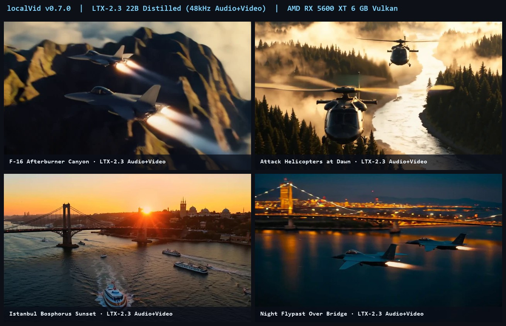
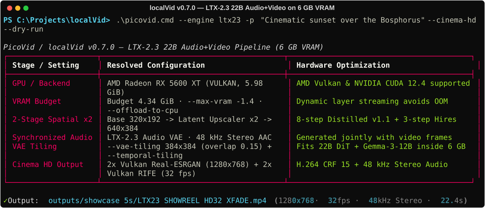
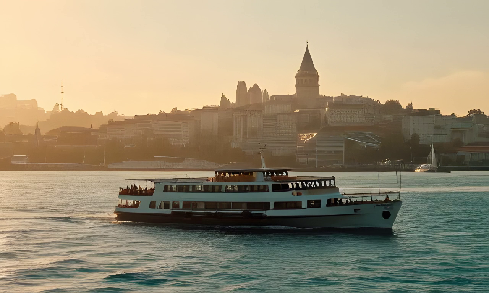

# PicoVid v0.7.0 — Düşük Donanımlı 4–6 GB GPU'larda (AMD & NVIDIA) Yerel Ses+Video Yapay Zeka Stüdyosu

[](https://github.com/ffalcon3098-droid/localVid/actions/workflows/tests.yml)
[](LICENSE)

**[English](README.md) · [Türkçe](README.tr.md)** · **Platform:** Windows 10/11 (x64) · **GPU Desteği:** AMD Radeon (Vulkan), NVIDIA GeForce GTX/RTX (CUDA & Vulkan), Intel Arc (Vulkan)

> **Durum / Bilinen Sınırlar (Beta):** Fiziksel testler **AMD Radeon RX 5600 XT (6 GB VRAM) + 32 GB RAM (Windows 11)** üzerinde doğrulandı. NVIDIA CUDA kurulumu backend-bağımsız `ggml` hatlarını kullanır ancak henüz **topluluk testine açıktır**; şimdilik **yalnızca Windows 10/11 x64** desteklenir. Sorun bildirimi için lütfen `py scripts/probe_hardware.py` çıktısıyla GitHub Issue açın.

> **Amiral gemisi 22B Ses + Video üretim modelini (`LTX-2.3 Distilled v1.1` · T2V, I2V, FLF2V + 48 kHz Stereo Ses), hızlı 5 saniyelik `Wan 2.2 TI2V-5B Turbo`'yu ve `Z-Image-Turbo`'yu sıradan 4–6 GB VRAM'li kartlarda (AMD Vulkan & NVIDIA CUDA) çalıştırır — İngilizce varsayılan Web Stüdyosu & CLI, 2-aşamalı natif x2 latent yükseltme, 4.3×–11.6× daha hızlı Video VAE, Ses Korumalı Sinema HD (`1280×768 @ 32fps`) ve Çoklu Klip Zaman Çizelgesi (`xfade` + stereo `acrossfade`) içerir.**

<p align="center">
  
</p>

<p align="center">
  
</p>

<p align="center">
  
</p>

## AMD & NVIDIA GPU Uyumluluğu + Dürüst Donanım Katmanları

Tüm düşük-VRAM akış optimizasyonları backend-bağımsız `ggml_backend_*` / `stable-diffusion.cpp` hatlarını kullanır; böylece **hem AMD (Vulkan) hem NVIDIA (CUDA & Vulkan)** kullanıcıları 4–6 GB kartlarda güçlü video modellerini çalıştırabilir:

| Sistem Katmanı (VRAM + Sistem RAM) | Uyumlu GPU'lar (AMD & NVIDIA) | En Uygun Modeller | Notlar |
|---|---|---|---|
| **4–6 GB VRAM + 16 GB RAM** *(Giriş / Düşük Donanım)* | GTX 1650/1660, RTX 2060/3050, RX 5500/5600 XT, Intel Arc | **`Wan 2.2 TI2V-5B Turbo`** (`7.92 GiB`) + **`Z-Image-Turbo`** (`6.24 GiB`) | Düşük RAM kullanımıyla hızlı 5 saniyelik klipler (~3–6 dk) ve 22 sn ilk kare üretimi. |
| **6 GB VRAM + 32 GB RAM** *(Doğrulanmış İdeal)* | **RX 5600 XT 6 GB (Fiziksel Doğrulandı)**, RTX 2060/3060 Laptop | **`LTX-2.3 22B Ses+Video`** (`24.09 GiB`) + **`Wan 2.2 14B`** | 2-aşamalı x2 yükseltici ve Ses Korumalı Sinema HD (`1280×768 @ 32fps`) ile tam 22B Ses+Video. |
| **8 GB+ VRAM + 32 GB RAM** *(Orta Segment)* | RTX 3060/4060/4070, RX 6600/7600+ | Tüm modeller (`LTX-2.3 22B` + `Wan 2.2` + `Z-Image`) | Geniş VRAM tavanı sayesinde `--max-vram` kısıtlaması kalkar, daha yüksek adım hızı alınır. |

## v0.6.0–v0.7.0 Yenilikleri

- **İngilizce Varsayılan Web Stüdyosu, Terminal Paneli, Sihirbaz & Kurulum (`v0.7.0`):** `web_ui.py` (`<html lang="en">`), `ui_console.py`, `generate.py`, `postprocess.py`, `download_models.py`, `picovid.cmd` ve `setup.ps1` temiz İngilizce varsayılanına geçirildi (etkileşimli onaylarda hem `y/n` hem `e/h` tuşları desteklenir).
- **Web Stüdyosu Güvenlik Kalkanı & LTX-2.3 Hız/Kalite İyileştirmeleri (`v0.6.0`):**
  - Katı `Host`/`Origin`/`Content-Type`/`X-PicoVid-Token` CSRF koruması, sıkı `OUTPUTS_DIR` + medya uzantısı izin listesi (`is_relative_to()`), SVG/HTML XSS yükleme engeli, `postprocess.py` Zip-Slip koruması ve tam süreç-ağacı iptali (`taskkill /F /T /PID`).
  - Gemma-3 kodlarken arka planda LTX-2.3 DiT için `start_file_prewarm`, Vulkan'da `--flash-attn off`, Cinema HD öncesi `--compression-quality 100`, BT.709 H.264 renk etiketleri ve sıfır-kopyalı `os.replace()` kare dizileme.

## v0.5.0 Öne Çıkanlar (LTX-2.3 22B Ses+Video Motoru)

- **LTX-2.3 22B Distilled v1.1 (Varsayılan `--engine ltx23`):** **AMD RX 5600 XT 6 GB (Vulkan, 32 GB RAM)** üzerinde 8 adımda (`DISTILLED_SIGMA_VALUES`) sinema kalitesinde video **VE senkronize 48 kHz Stereo Ses** üretir; hazır `stable-diffusion.cpp` Vulkan ikilisi (`master-1133-52491bd`) ile C++ derleme gerektirmez.
- **6 GB VRAM İçin Ölçülmüş Hız Optimizasyonları (`~2.1×` Hızlanma + Daha Keskin Görüntü, Sıfır Kilitlenme):**
  - `--max-vram -1.4 --disable-prefetch`: `6.15 GiB` WDDM Shared VRAM taşmasını bitirir (`1.51×` daha hızlı DiT) ve `49f–81f` kliplerde prefetch kilitlenmesini engeller.
  - `--vae-tile-size 384x384 --vae-tile-overlap 0.15`: Video VAE çözümlemeyi **`4.3×–11.6×`** hızlandırır (`110.1s → 25.7s` / `149.3s → 12.8s`, **`41.31 dB PSNR`**).
  - **Otomatik 2-Aşamalı Natif x2 Spatial Latent Upscaler (`ltx-2.3-spatial-upscaler-x2-1.1.safetensors`):** İlk 8 adımı yarı çözünürlükte (`320×192 → 640×384` veya `384×224 → 768×448`), son 3 iyileştirme adımını (`STAGE_2_DISTILLED_SIGMA_VALUES`) hedef çözünürlükte çalıştırır — **`1.41×–2.0×` ek hızlanma** ve belirgin biçimde daha düzgün nesne anatomisi!
- **Ses Korumalı Sinema HD (`postprocess.py`):** 2× Vulkan Real-ESRGAN (`1280×768`) + 32 fps akıcılık uygulanırken LTX-2.3'ün 48 kHz Stereo AAC sesi eksiksiz korunur.
- **Çoklu Klip Zaman Çizelgesi & Geçişler (`web_ui.py` & `postprocess.build_timeline_video`):** Web Stüdyosu (`http://127.0.0.1:7860`) üzerinden klipleri sıraya dizin, `xfade` geçiş efektini (`dissolve`, `fadeblack`, `wipeleft`, `smoothleft`, `circleopen`, `cut`) seçin ve senkronize stereo `acrossfade` ile tek MP4 olarak dışa aktarın.

### LTX-2.3 22B Ölçülmüş Benchmarklar (AMD RX 5600 XT 6 GB Vulkan, Windows 11, 32 GB RAM)

| Yapılandırma (`LTX-2.3 22B Distilled 1.1 Q4_K_M + Gemma-3-12B`) | Çıktı | DiT Süresi | Video VAE | Ses VAE | Toplam | Not |
|---|---|---:|---:|---:|---:|---|
| Eski Varsayılan (`--max-vram 0`, `256×256` karo) | `640×384 × 17f` | `959.5 s` | `110.1 s` | `4.0 s` | `1190.7 s` | `6.95 GiB` Shared taşması |
| Optimize (`--max-vram -1.4`, `384×384` karo) | `640×384 × 17f` | **`636.5 s`** (`1.51×`) | **`25.7 s`** (`4.28×`) | `4.0 s` | **`775.7 s`** (`1.54×`) | `41.31 dB PSNR` |
| Güvenli Tek-Aşama (`--max-vram -1.4 --disable-prefetch`) | `640×384 × 25f` | `766.6 s` | **`12.8 s`** | `3.9 s` | `880.9 s` | Sıfır kilitlenme |
| **Otomatik 2-Aşamalı Natif x2 Upscaler (`320×192 → 640×384`)** | **`640×384 × 25f`** | **`542.8 s`** (`288s + 255s`) | **`12.5 s`** | **`4.0 s`** | **`699.6 s`** | **En hızlı + en keskin anatomi** |
| Tam 5 Saniye Klip + Ses Korumalı Sinema HD | `1280×768 × 81→160f @ 32fps` | — | — | `24.4 s` | — | 5×5 sn Showreel ile doğrulandı (`22.45s` xfade MP4) |

```powershell
# Tek tıkla kurulum (hazır LTX-2.3 Vulkan motoru + Cinema HD + modeller, Visual Studio gerekmez!)
.\setup.cmd

# PicoVid v0.5.0 Web Stüdyosu (LTX-2.3 T2V/I2V/Stüdyo + Çoklu Klip Zaman Çizelgesi)
.\web-studio.cmd

# CLI: 5 saniyelik LTX-2.3 Ses+Video (Otomatik 2-Aşamalı x2 Upscaler + Ses Korumalı 1280x768 @ 32fps)
py scripts/generate.py --engine ltx23 --mode t2v --cinema-hd -p "Two F-16 fighter jets flying over the illuminated Istanbul Bosphorus Bridge at dusk, roaring jet afterburners" -W 640 -H 384 -f 81 --fps 16 -o istanbul_f16_hd32.mp4
```

---

## Geçmiş Wan 2.2 Düşük-VRAM Yama Araştırması (`v0.1–v0.4`)


***AMD Radeon RX 5600 XT (6 GB VRAM, Vulkan, Windows 11)** üzerinde yerel olarak üretilmiştir — `640×384`, 33 kare (2.1 sn), 4 adım (`wan2.2-t2v-rapid-aio-v10-Q4_K`), gerçek Wan 2.1 VAE, uçtan uca ~8.7 dk.*

| Kare 12 (`17f`, toplam 4.5 dk) | Kare 32 (`33f`, `Q_CHUNK=2048`) |
|---|---|
|  |  |

---

## Neden PicoVid?

Stok [`leejet/stable-diffusion.cpp`](https://github.com/leejet/stable-diffusion.cpp) üzerinde ağır bir **14B video modeli (Wan 2.2)** 4–6 GB VRAM'li kartlarda çalıştırıldığında 5 kritik duvara çarpar:

1. **WDDM Shared Memory Taşması (2.75–4.03 GiB PCIe Thrashing):** Tahliye edilmeyen blok ağırlıkları (`40 × 219 MB = 8.75 GB`) sessizce PCIe üzerinden sistem RAM'ine taşar ve hızı ~3–10× düşürür.
2. **Windows 2 Saniyelik TDR Çöküşü (`vk::Queue::submit: ErrorDeviceLost`):** `640×384`'te bölünmemiş tek bir Wan bloğu RDNA 1 Vulkan Flash Attention ile >6 sn sürdüğü için `blocks.0`'da sürücü sıfırlanır.
3. **Vulkan `maxMemoryAllocationSize = 2.0 GiB` Sınırı:** Uzun klipler (`49f–81f`) ve Wan 2.1 VAE 3D `im2col` tamponları 2 GiB tek buffer sınırını aşar.
4. **Aşırı Dar `conv2d/conv3d direct` Probe Eşiği:** RDNA 1 Vulkan'da zararsız `0.0037` FP16 yuvarlama farkı (`non_finite = 0`) `0.001` eşiğini geçtiği için `conv3d direct` kapatılır ve Wan 2.1 VAE 6.97–8.53 GB VRAM ister.
5. **Süreç-İçi VAE OOM & Normalizasyon Tuzağı:** DiT sürecinde VAE çalıştırmak VRAM'i parçalar; `--taesd` ile kaydedilen ham DiT latent'i `dit_to_vae_latents` uygulanmadan Wan 2.1 VAE'ye vermek diyagonal kafes artefaktı oluşturur.

**PicoVid**, bu 5 sorunun tamamını **9 adet modüler, varsayılanı OFF, %100 backend-bağımsız (`ggml_backend_*`) yama** ile hem **Vulkan** hem **CUDA** için çözer.

---

## Ölçülmüş Benchmark Sonuçları (AMD Radeon RX 5600 XT 6 GB Vulkan, Windows 11, 32 GB RAM)

*Not: Test sisteminde boşta masaüstü tabanı `2,914 MiB` Dedicated / `473 MiB` Shared VRAM'dir — tabloda `sd-cli` net VRAM artışı (`Δ`) ayrıca gösterilmiştir.*

### 1. Hızlanma Kırılımı (1 Adım, Wan 2.2 14B Q4_K_M)

| Çözünürlük × Kare | Yapılandırma | Self-Attn / Blok (40 head) | DiT 1 Adım | Hızlanma | DiT Compute Buffer | Net Dedicated VRAM (`Δ`) | Durum |
|---|---|---:|---:|---:|---:|---:|---|
| `480×320 × 17f` | Stok `sd.cpp` (`--max-vram 3.8`, FA on) | — | `356.10 s` | `1.00×` | `345.2 MB` | `+1,563 MiB` (`+2,281` Shared!) | VAE OOM fallback |
| `480×320 × 17f` | P1 (`mv=1.5`, `evict_on_end`, FA on) | — | `137.73 s` | `2.59×` | `345.2 MB` | **`+1,333 MiB`** | OK |
| **`480×320 × 17f`** | **localVid P1+P2 (`HEAD_CHUNK=4`, FA off)** | **`78.0 ms`** | **`38.36 s`** | **`9.28×`** | **`381.6 MB`** | **`+1,518 MiB`** | **OK** |
| `640×384 × 17f` | Stok `sd.cpp` / P1 (FA on) | *(TDR çöküş)* | **ÇÖKTÜ (`23 s`)** | — | `547.3 MB` | — | `ErrorDeviceLost` |
| `640×384 × 17f` | P2 (`HEAD_CHUNK=8`, FA on) | `6,265.0 ms` | `296.50 s` | `1.00×` | `375.0 MB` | `+1,300 MiB` | TDR Çözüldü |
| **`640×384 × 17f`** | **localVid P1+P2 (`HEAD_CHUNK=4`, FA off)** | **`168.0 ms` (`37.3×`)** | **`56.60–58.70 s`** | **`5.05×`** | **`592.5 MB`** | **`+1,187–1,507 MiB`** | **OK** |

### 2. `640×384` Kare Tavanı Merdiveni (81 Kare / 5.1 sn, 1 Adım + Ayrı Süreç Wan 2.1 VAE)

| Kare (`@16fps`) | Token (`N`) | Profil | DiT (1 Adım) | DiT Compute Buffer | Ayrı Süreç Wan 2.1 VAE (`conv_direct=on`) | Net DiT Dedicated (`Δ`) | Durum |
|---|---:|---|---:|---:|---:|---:|---|
| **`17f`** (`1.1 sn`) | `4,800` | Hızlı (`q=off, mv=1.5`) | **`56.60 s`** | `592.5 MB` | **`34.63 s`** (`1,441 MB`) | `+1,187 MiB` | **OK** |
| **`33f`** (`2.1 sn`) | `8,640` | Hızlı (`q=2048, mv=2.0`) | **`114.51 s`** | `675.0 MB` | **`64.78 s`** (`1,617 MB`) | `+1,656 MiB` | **OK** |
| **`49f`** (`3.1 sn`) | `12,480` | Hızlı (`q=1024, mv=2.5`) | **`195.97 s`** | `1,500.5 MB` | **`131.94 s`** (`1,617–1,922 MB`) | `+1,834 MiB` | **OK** |
| **`81f`** (`5.1 sn`) | `20,160` | Sığdırma (`QKV_SPLIT=1`, `CUT_HOST=32`, `q=1024`, `mv=2.5`) | **`728.03 s`** | **`1,890.0 MB`** (`< 2 GiB`) | **`230.16 s`** (`1,617–1,922 MB`) | `+2,110 MiB` | **OK** |

### 3. Gerçek 4-Adımlı Uçtan Uca Video & v0.2 Stüdyo Modu (`640×384`, Ayrı Süreç Wan 2.1 VAE, H.264 CRF 16)

| Hat (`640×384`) | İlk Kare (T2I) | I2V `vae_encode` | TE (CPU) | DiT (4 Adım) | Wan 2.1 VAE (`conv_direct=on`) | Toplam Uçtan Uca |
|---|---:|---:|---:|---:|---:|---:|
| **T2V — 17 kare (1.1 sn)** (`Rapid-AIO v10 Q4_K`) | — | — | `22.2 s` | `209.4 s` | `34.6 s` | **~4.5 dk** |
| **T2V — 33 kare (2.1 sn)** (`Rapid-AIO v10 Q4_K`) | — | — | `13.4 s` | `444.1 s` | `64.8 s` | **~8.7 dk** |
| **v0.2 Stüdyo Modu (T2I → I2V 17f)** (`Z-Image-Turbo` + `Wan 2.2 I2V LightX2V MoE Q4_K_M`, GPU-tiled `vae_encode`) | **`21.9 s`** *(832×480: `32.1 s`)* | **`19.3 s`** *(216s CPU'dan 11.2× hızlı)* | `18.2 s` | **`234.5 s`** *(2 High + 2 Low)* | **`35.7 s`** | **~5.6 dk** |
| **v0.3 Sinema HD (`--cinema-hd`, `640×384×17f` → `1280×768 HD @ 32fps`)** | **`21.9 s`** | **`19.3 s`** | `18.2 s` | **`~195–210 s`** *(Faz A: `HEAD_CHUNK=8`, `clear()` prefetch, NVMe ön-ısıtma)* | **`35.7 s`** + **`49.7 s`** (`x4plus` 2× HD + 32fps optik akış) *(veya `~8 s` `animevideov3`)* | **~5.5 dk (`1280×768 @ 32fps`)** |
| **v0.3 Hızlı 5 Saniye (`--engine 5b`, `Wan 2.2 TI2V-5B Turbo`, `640×384 × 81f @ 16→32fps` = 5.0s!)** | *(ops. `21.9 s`)* | **`1.3 s`** *(tek-kare frozen I2V!)* | `13.1 s` | **`74.2 s`** *(`18.5 s/adım`, `%80.4` GPU verimi)* | **`167.8 s`** (`Wan 2.2 VAE 224×224`, 6 karo) + **`30.1 s`** (`1280×768 @ 32fps`) | **~4.8 dk (`1280×768 @ 32fps`!)** |
| **v0.3 Fotogerçekçi 5 Saniye (`--engine 5b`, doğal `832×480 × 81f @ 16→32fps`, `beta` scheduler)** | *(ops. `32.1 s`)* | **`2.1 s`** | `13.4 s` | **`140.0 s`** *(`35.0 s/adım`)* | **`334.9 s`** (`224×256` ile 8 karoya indi!) + **`11.3 s`** (`32fps` AOBMC) | **~8.4 dk (`832×480 @ 32fps`, keskin doku)** |
| **v0.3 Hızlı 5 Saniye (`--engine 5b`, `640×384 × 121f @ 24fps` native = 5.04s)** | *(ops. `21.9 s`)* | **`1.3 s`** | `15.6 s` | **`124.1 s`** *(`30.2 s/adım`, PeakDed `4,346 MiB`)* | **`352.5 s`** (`Wan 2.2 VAE 192×192`) / **`1.9 s`** (`--fast-preview` `taew2_2`) | **~2.4 dk (TAEW) · ~7.9 dk (Tam VAE)** |
| **`832×480 × 33f` Native 14B I2V (Faz A Shared=0)** | — | — | — | **`232.7 s/adım`** *(öncesi `613.2 s/adım` → **`2.64×` hızlı**)* | — | **~15.5 dk** *(~45 dk'dan düştü)* |

| Stüdyo İlk Kare (`Z-Image-Turbo 6B`, `832×480`, `32.1 s`) | Canlandırılmış I2V Son Kare (`Wan 2.2 I2V MoE`, GPU-tiled `vae_encode`, `PSNR 39.35 dB`) | v0.3 Sinema HD Çıktısı (`1280×768 HD @ 32fps`, `realesrgan-x4plus` 2× + AOBMC) |
|---|---|---|
|  |  |  |

---

## Hızlı Kurulum ve Çalıştırma (Windows)

### 0. Sıfırdan Tek Tıkla Otomatik Kurulum (Temiz Bilgisayarda Önerilen)

```powershell
# Eksik Git / Python / VS 2022 C++ Build Tools / CUDA veya Vulkan SDK'yi otomatik kurar,
# 9 yamayı uygular, sd-cli.exe'yi derler, Cinema HD aracını ve donanıma uygun modelleri indirir!
.\setup.cmd
```

### 1. Manuel Kaynak Çekme, Yama Uygulama ve Derleme

```powershell
git clone --depth 1 --recurse-submodules --shallow-submodules https://github.com/leejet/stable-diffusion.cpp.git third_party/stable-diffusion.cpp
git -C third_party/stable-diffusion.cpp checkout 3b12781

# 9 modüler yamayı uygula
powershell -ExecutionPolicy Bypass -File scripts/apply_patches.ps1

# Derle (AMD/Intel/NVIDIA için -Backend vulkan, NVIDIA CUDA için -Backend cuda)
powershell -ExecutionPolicy Bypass -File scripts/build.ps1 -Backend vulkan
```

### 2. Akıllı Donanım Duyarlı Model İndirme (`configs/models_registry.json`, Apache 2.0)

```powershell
py -m pip install -r requirements.txt

# Donanım duyarlı sihirbaz (GPU VRAM, Sistem RAM ve boş diski okuyup ★ Önerilen paketi seçer)
py scripts/download_models.py

# Veya doğrudan profil indir:
py scripts/download_models.py --profile t2v --with-taehv       # T2V Başlangıç (~12.6 GiB)
py scripts/download_models.py --profile studio                 # Stüdyo T2I + I2V Q4_K_M (~27.9 GiB)
py scripts/download_models.py --profile studio-compact         # Stüdyo Kompakt Q3_K_M (~23.3 GiB)
```

### 3. Video Üret (Yerel Web Stüdyosu, İnteraktif TUI veya Tek Komut CLI)

```powershell
# Yerel Web Stüdyosu (ek kurulum gerektirmez — http://127.0.0.1:7860, canlı VRAM, önizleme/onay, model durumu & +5sn Uzat)
.\web-studio.cmd
# veya: .\picovid.cmd --web

# İnteraktif terminal sihirbazı (5sn/10sn/15sn seçenekleri, T2V / I2V / Stüdyo Modu)
.\picovid.cmd

# Hızlı 5 Saniyelik Video (Wan 2.2 TI2V-5B Turbo: 81f @ 16->32fps = 5.0 sn, ~4.8 dk!)
py scripts/generate.py --engine 5b --mode studio --cinema-hd -p "A cinematic wide shot of the Bosphorus at golden hour, historic ferry gliding across sparkling water, 35mm film" -W 640 -H 384 -f 81 --fps 16 -o bogaz_5sn_hd32.mp4

# Kesintisiz 10 Saniyelik Çoklu-Segment Video (--segments 2 + bölüm bazlı yönetmen prompt'u + Lab renk çıpası)
py scripts/generate.py --engine 5b --mode studio --segments 2 -f 81 --fps 16 --cinema-hd --segment-prompts "Historic ferry gliding across the golden Bosphorus | Sweeping aerial pull-back over Istanbul skyline, seagulls soaring" -W 640 -H 384 -o bogaz_10sn_32fps.mp4

# Mevcut herhangi bir MP4 videoyu son karesinden kesintisiz uzat (+5 sn devam)
py scripts/generate.py --engine 5b --extend-video bogaz_5sn_hd32.mp4 -p "Camera rises smoothly into an aerial view at sunset" -W 640 -H 384 -f 81 --cinema-hd -o bogaz_uzatilmis_10sn.mp4

# Stüdyo Modu + Sinema HD (14B kalite, 640x384 -> 1280x768 HD @ 32fps H.264 CRF 15, ~5.5 dk)
py scripts/generate.py --mode studio --cinema-hd -p "A cinematic wide shot of the Bosphorus at golden hour, historic ferry gliding across sparkling water, 35mm film" -W 640 -H 384 -f 17 -o bogaz_hd32.mp4

# Bağımsız son-işleme (herhangi bir videoya 2x Vulkan Real-ESRGAN + 2x 32fps optik akış)
py scripts/postprocess.py -i bogaz_studio.mp4 -o bogaz_hd32.mp4 --upscale 2 --rife 2

# Doğrudan Görselden Videoya (Wan 2.2 I2V LightX2V MoE)
py scripts/generate.py --mode i2v -i gorselim.png -p "Slow cinematic camera pan, gentle natural motion" -W 832 -H 480 -f 17 -o canlandirma.mp4

# Metinden Videoya (Wan 2.2 T2V Rapid-AIO v10)
py scripts/generate.py -p "A cinematic tracking shot of a vintage red sports car driving down a rain-slicked neon-lit city street at sunset" -W 640 -H 384 -f 33 -o cikti_33f.mp4

# 5 saniyelik canlı arayüz demosu / kuru donanım doğrulaması
py scripts/generate.py --ui-demo
py scripts/generate.py --mode studio -p "test" -W 832 -H 480 -f 33 --dry-run
```

---

## Donanım Destek Matrisi (Dürüst Doğrulama Durumu)

| Donanım / Platform | Backend | Durum | Notlar |
|---|---|---|---|
| **AMD Radeon RX 5600 XT (6 GB, RDNA 1), Windows 11, 32 GB RAM** | Vulkan | **Fiziksel Olarak Doğrulandı** | Tüm benchmark'lar (`17f–81f`, 4-adımlı temiz MP4'ler, `9.28×` hızlanma, `1.30–2.11 GiB` net VRAM) bu kartta ölçüldü. |
| **AMD / Intel 4–8 GB Kartlar (Windows / Linux)** | Vulkan | **Mimari Hazır (Topluluk Testi Bekleniyor)** | Saf `ggml-vulkan` + `probe_hardware.py` heap bütçesi tespiti kullanır. |
| **NVIDIA 4–8 GB Kartlar (GTX 1050 Ti / RTX 2060 / 3050 / 3060 / 4060)** | CUDA | **Mimari Hazır (Topluluk Testi Bekleniyor)** | 9 yamanın tamamı backend-bağımsız `ggml_backend_*` API kullanır; `generate.py` CUDA profillerini otomatik seçer (`--simulate-profile cuda-4gb` doğrulandı). |

*Not: Sistem RAM gereksinimi `Wan 2.2 TI2V-5B` / `Z-Image-Turbo` için **16 GB**, `LTX-2.3 22B + Gemma-3-12B` veya uzun `Wan 2.2 14B` klipleri için **24–32 GB**'dır.*

---

## Lisans ve Üçüncü Parti Modeller

- **PicoVid kaynak kodu, betikleri, Web Stüdyosu ve yamaları** **[Apache License 2.0](LICENSE)** ile lisanslanmıştır.
- **İndirilen model ağırlıkları ve opsiyonel araçlar** bu repoda barındırılmaz; kendi kaynak lisanslarına tabidir (`configs/models_registry.json` dosyasında dosya bazlı belirtilir):
  - `Wan 2.2`, `Z-Image-Turbo`, `Qwen3-4B`: **Apache-2.0**
  - `LTX-2.3 22B Distilled`: **LTX Community License** (Lightricks)
  - `Gemma 3 12B`: **Gemma Terms of Use** (Google)
  - `TAEHV` & `rife-ncnn-vulkan`: **MIT** · `realesrgan-ncnn-vulkan`: **BSD-3-Clause**
- [`leejet/stable-diffusion.cpp`](https://github.com/leejet/stable-diffusion.cpp) ve [`ggml`](https://github.com/ggml-org/ggml) üzerine inşa edilmiştir.
- Düşük VRAM yama metodolojisi kısmen [`alexturkey/VideoTurko`](https://github.com/alexturkey/VideoTurko) projesinden ilham almıştır.
